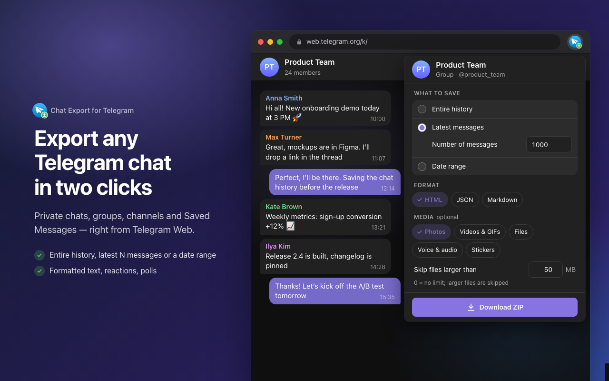

<p align="center">
  
</p>

<h1 align="center">Chat Export for Telegram Web</h1>

<p align="center">
  Export chat, group and channel history from Telegram Web to HTML, JSON and Markdown — with photos, videos and files.
</p>

<p align="center">
  <b>English</b> · <a href="README.ru.md">Русский</a>
</p>



## Features

- **Any chat:** private chats, bots, groups, channels and Saved Messages.
- **Flexible range:** the entire history, the latest N messages, or a date range.
- **Three formats:** HTML (a readable copy that opens offline), JSON (structured data) and Markdown (notes and knowledge bases). Pick several at once.
- **Media:** photos, videos and GIFs, voice and audio, files, stickers — with a file size limit.
- **Rich content:** formatted text and links, reactions, views, polls, locations, contacts, link previews and service messages.
- **Runs in the background:** close the popup and the export keeps going while the Telegram tab stays open.
- **Private:** everything runs locally in your browser. No servers, no analytics, no extra login.
- **English and Russian** interface, light and dark theme.

## Installation

1. Download `telegram-history-downloader-vX.Y.Z.zip` from the [latest release](https://github.com/itcaat/telegram-history-downloader/releases/latest) and unzip it.
2. Open `chrome://extensions` and turn on **Developer mode**.
3. Click **Load unpacked** and select the unzipped folder.

## Usage

1. Open [web.telegram.org/k/](https://web.telegram.org/k/) and select a chat, group or channel.
2. Click the extension icon.
3. Choose the range, formats and media types.
4. Click **Download**. You can close the popup — the export continues while the Telegram tab is open.

A single format without media is saved as one file. Otherwise you get a ZIP archive with `messages.{html,json,md}` and a `media/` folder.

## Privacy

The extension only works on `web.telegram.org`, processes everything locally and never sends your data anywhere. See the [privacy policy](docs/privacy-policy.md).

## Limitations

- Only Telegram Web K (`/k/`) is supported. The extension relies on Telegram Web internals and may break after Telegram Web updates.
- The archive is built in memory and ZIP64 isn't supported. For large channels with media, limit the date range and file size.

## Development

```bash
npm install
npm run build        # type check + build into dist/
npm run watch        # rebuild on changes
npm run screenshots  # regenerate store screenshots and promo images
```

To try a local build, load the `dist/` folder via **Load unpacked**.

CI (`.github/workflows/ci.yml`) builds the project on every push and pull request; the built `dist/` is available in the run artifacts.

Releases (`.github/workflows/release.yml`) are triggered by a semver tag:

```bash
make release              # v1.2.3 → v1.2.4
make release BUMP=minor   # v1.2.3 → v1.3.0
make release BUMP=major   # v1.2.3 → v2.0.0
```

`make release` only runs from `main` with a clean working tree in sync with `origin/main`. It takes the latest tag from GitHub via `gh`, writes the new version to `package.json`, `package-lock.json` and `manifest.json` (`scripts/set-version.mjs`), commits and pushes it to `main`, then tags that commit and pushes the tag. If there are no tags yet, the version from `package.json` is used.

For stable tags the Release workflow checks that the committed `manifest.json` and `package.json` versions match the tag and fails otherwise. A pre-release can be tagged manually without committing the version: `git tag v1.2.3-beta.1 && git push origin v1.2.3-beta.1`. In that case CI sets `version` to `1.2.3` and `version_name` to the full version. The extension ZIP is attached to the GitHub Release.

### How it works

```
popup ──chrome.tabs.sendMessage──▶ content/bridge.js (isolated world)
                                        │ window.postMessage
                                        ▼
                                  content/main.js (MAIN world)
                                        │ window.rootScope.managers.*
                                        ▼
                              Telegram WebK MTProto session
```

- `src/main` runs in the page context and calls the internal WebK managers exposed on `window`:
  - `apiManager.invokeApi('messages.getHistory')` loads messages;
  - `apiFileManager.download()` downloads files.
- The export runs inside the tab, so it doesn't depend on the popup being open.
- Media is downloaded page by page while `file_reference` values are still valid.
- `src/content/bridge.ts` relays commands between the popup and the page.
- `src/popup` is the UI (English and Russian via `chrome.i18n`).

### Docs

- [Chrome Web Store listing](docs/chrome-web-store.md) — store texts, SEO, images and privacy answers (in Russian).
- [Privacy policy](docs/privacy-policy.md)

## Disclaimer

This is an unofficial extension and is not affiliated with Telegram FZ-LLC. Telegram is a trademark of its respective owner.
