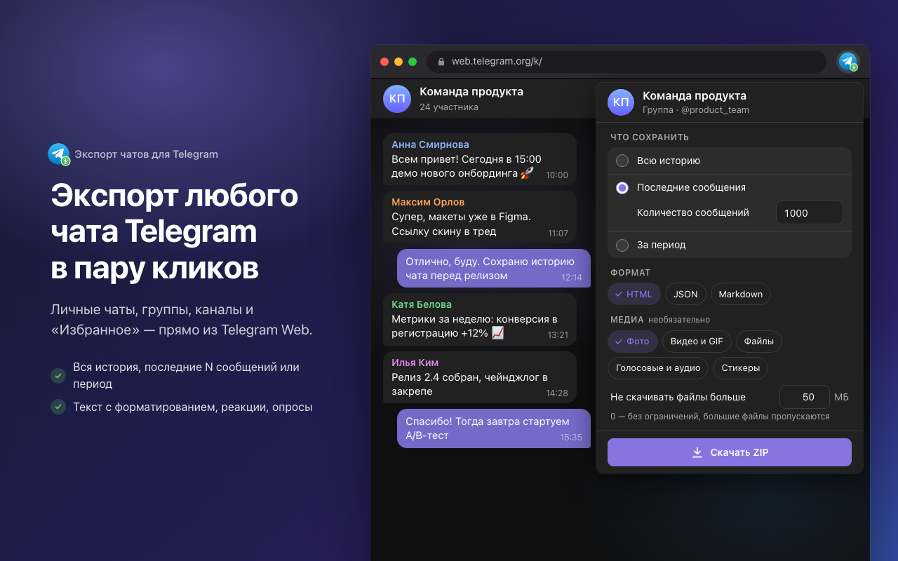

<p align="center">
  
</p>

<h1 align="center">Экспорт чатов для Telegram Web</h1>

<p align="center">
  Экспорт истории чатов, групп и каналов из Telegram Web в HTML, JSON и Markdown — с фото, видео и файлами.
</p>

<p align="center">
  <a href="README.md">English</a> · <b>Русский</b>
</p>



## Возможности

- **Любые чаты:** личные переписки, боты, группы, каналы и «Избранное».
- **Гибкий диапазон:** вся история, последние N сообщений или период.
- **Три формата:** HTML (читаемая копия, открывается без интернета), JSON (структурированные данные) и Markdown (заметки и базы знаний). Можно выбрать несколько сразу.
- **Медиа:** фото, видео и GIF, голосовые и аудио, файлы, стикеры — с лимитом размера файла.
- **Всё содержимое:** текст с форматированием и ссылками, реакции, просмотры, опросы, геопозиции, контакты, превью ссылок и служебные сообщения.
- **Работает в фоне:** окно расширения можно закрыть — экспорт продолжится, пока открыта вкладка Telegram.
- **Приватно:** всё работает локально в браузере. Без серверов, аналитики и отдельного входа.
- Интерфейс **на русском и английском**, светлая и тёмная тема.

## Установка

1. Скачайте `telegram-history-downloader-vX.Y.Z.zip` из [последнего релиза](https://github.com/itcaat/telegram-history-downloader/releases/latest) и распакуйте.
2. Откройте `chrome://extensions` и включите **Режим разработчика**.
3. Нажмите **Загрузить распакованное расширение** и выберите распакованную папку.

## Использование

1. Откройте [web.telegram.org/k/](https://web.telegram.org/k/) и выберите чат, группу или канал.
2. Нажмите на иконку расширения.
3. Выберите диапазон, форматы и типы медиа.
4. Нажмите **Скачать**. Окно можно закрыть — экспорт продолжится, пока открыта вкладка Telegram.

Один формат без медиа сохраняется одним файлом. В остальных случаях получается ZIP-архив: `messages.{html,json,md}` и папка `media/`.

## Приватность

Расширение работает только на `web.telegram.org`, обрабатывает всё локально и никуда не отправляет ваши данные. Подробнее — в [политике конфиденциальности](docs/privacy-policy.md#русский).

## Ограничения

- Поддерживается только Telegram Web K (`/k/`). Расширение зависит от внутренних механизмов Telegram Web и может сломаться после его обновлений.
- Архив собирается в памяти, а ZIP64 не поддерживается. Для больших каналов с медиа ограничивайте период и размер файлов.

## Разработка

```bash
npm install
npm run build        # проверка типов + сборка в dist/
npm run watch        # пересборка при изменениях
npm run screenshots  # перегенерировать скриншоты и промо-изображения для магазина
```

Чтобы попробовать локальную сборку, загрузите папку `dist/` через **Загрузить распакованное расширение**.

CI (`.github/workflows/ci.yml`) собирает проект на каждый push и pull request; собранный `dist/` доступен в артефактах запуска.

Релиз (`.github/workflows/release.yml`) запускается по semver-тегу:

```bash
make release              # v1.2.3 → v1.2.4
make release BUMP=minor   # v1.2.3 → v1.3.0
make release BUMP=major   # v1.2.3 → v2.0.0
```

`make release` работает только из `main` с чистым рабочим деревом, синхронизированным с `origin/main`. Последний тег берётся из GitHub через `gh`, новый тег ставится на текущий коммит и пушится. Если тегов ещё нет, используется версия из `package.json`. Pre-release можно выпустить вручную: `git tag v1.2.3-beta.1 && git push origin v1.2.3-beta.1`.

Версия из тега проставляется в `package.json` и `manifest.json` (`version` — `1.2.3`, `version_name` — полная версия), а ZIP с расширением прикрепляется к GitHub Release.

### Как это работает

```
popup ──chrome.tabs.sendMessage──▶ content/bridge.js (isolated world)
                                        │ window.postMessage
                                        ▼
                                  content/main.js (MAIN world)
                                        │ window.rootScope.managers.*
                                        ▼
                              MTProto-сессия Telegram WebK
```

- `src/main` выполняется в контексте страницы и вызывает внутренние менеджеры WebK, которые тот выставляет в `window`:
  - `apiManager.invokeApi('messages.getHistory')` — загрузка сообщений;
  - `apiFileManager.download()` — загрузка файлов.
- Экспорт выполняется внутри вкладки, поэтому он не зависит от того, открыт ли попап.
- Медиа скачиваются постранично, пока `file_reference` ещё действительны.
- `src/content/bridge.ts` пересылает команды между попапом и страницей.
- `src/popup` — интерфейс (RU/EN через `chrome.i18n`).

### Документы

- [Листинг в Chrome Web Store](docs/chrome-web-store.md) — тексты для магазина, SEO, изображения и ответы для вкладки Privacy.
- [Политика конфиденциальности](docs/privacy-policy.md#русский)

## Отказ от ответственности

Расширение не является официальным продуктом Telegram и не связано с Telegram FZ-LLC. Telegram — товарный знак его владельца.
