# Chrome Web Store: листинг расширения

Тексты для карточки расширения в Chrome Web Store на русском и английском, а также ответы для вкладок Privacy и Distribution.

Chrome Web Store не отображает Markdown: описание публикуется как обычный текст. Поэтому тексты для копирования лежат в блоках кода. Списки оформлены символом «•», абзацы разделены пустой строкой.

## SEO: как ищет Chrome Web Store

- **Поле для ключевых слов в магазине нет.** В поиске учитываются название, краткое описание (summary) и полное описание. Больше всего весит название, потом summary.
- **Название и summary берутся из `manifest.json`** (`__MSG_extName__`, `__MSG_extDescription__` в `public/_locales/*/messages.json`). Тексты в манифесте и в этом документе должны совпадать, иначе в магазине будет одно, а в `chrome://extensions` — другое.
- **Лимиты:** название — до 75 символов (лучше до 45, чтобы влезало в карточку поиска); summary — до 132 символов; описание — до 16 000 символов.
- **Каждый язык ищется отдельно.** Русский листинг видят пользователи с русским интерфейсом Chrome, поэтому ключевые слова переводятся по смыслу, а не дословно.
- **Без переспама ключевыми словами.** Политика [Keyword Spam](https://developer.chrome.com/docs/webstore/program-policies/keyword-spam) запрещает списки ключевых слов, повторы и упоминание чужих брендов без причины. Ключевые слова встраиваются в обычные предложения; каждое повторяется в описании 1–3 раза.
- **Самое важное — в первых строках.** В карточке и поиске видна только первая пара строк описания, дальше пользователь читает, только если раскрыл описание.
- **Товарный знак.** Telegram — чужой бренд. По [политике магазина](https://developer.chrome.com/docs/webstore/program-policies/impersonation-and-intellectual-property) нельзя создавать впечатление, что расширение официальное. Формулировка «… for Telegram» безопаснее, чем название, начинающееся с «Telegram». В описании прямо сказано, что расширение неофициальное.

### Ключевые запросы

Использовать в тексте естественно, без списков.

| Русский | English |
| --- | --- |
| экспорт чата Telegram | export Telegram chat |
| скачать историю переписки Telegram | download Telegram chat history |
| сохранить переписку / бэкап чата | save Telegram messages / chat backup |
| экспорт канала / группы Telegram | export Telegram channel / group |
| Telegram Web, web.telegram.org | Telegram Web, web.telegram.org |
| скачать фото и видео из Telegram | download Telegram photos and videos |
| экспорт в HTML, JSON, Markdown | export to HTML, JSON, Markdown |
| архив переписки | chat archive |

## Название

Рекомендуемое (около 45 символов, бренд не в начале):

| Язык | Название | Символов |
| --- | --- | --- |
| RU | `Экспорт чатов для Telegram Web — HTML, JSON, MD` | 47 |
| EN | `Chat Export for Telegram Web — HTML, JSON, MD` | 45 |

Текущее название в манифесте — `Telegram History Downloader` (27 символов). Его можно оставить, но оно начинается с чужого бренда и не содержит слов «export», «chat», «экспорт», по которым ищут чаще всего. При смене нужно обновить `extName` в обоих `messages.json`.

## Краткое описание (summary)

До 132 символов. Должно совпадать с `extDescription` в `public/_locales/*/messages.json`.

RU (126 символов):

```text
Экспорт истории чатов, групп и каналов из Telegram Web в HTML, JSON и Markdown. С фото, видео и файлами. Всё в вашем браузере.
```

EN (132 символа — ровно на лимите):

```text
Export Telegram Web chat, group and channel history to HTML, JSON or Markdown — with photos, videos and files. Runs in your browser.
```

## Полное описание

### Русский

```text
Сохраните историю любого чата, группы или канала из Telegram Web в удобный файл — в пару кликов, прямо в браузере. Экспорт в HTML, JSON и Markdown, с фото, видео, голосовыми и файлами или без них.

Откройте чат на web.telegram.org/k/, нажмите на иконку расширения, выберите, что сохранить, и нажмите «Скачать». Готовый файл или ZIP-архив появится в папке загрузок.

ЧТО МОЖНО ЭКСПОРТИРОВАТЬ
• Личные переписки, чаты с ботами, группы, каналы и «Избранное».
• Всю историю, последние N сообщений или сообщения за выбранный период.
• Текст с форматированием и ссылками, реакции, просмотры, опросы, геопозиции, контакты, превью ссылок и служебные сообщения.

ФОРМАТЫ
• HTML — читаемая копия переписки, которую можно открыть в любом браузере без интернета.
• JSON — структурированные данные для анализа, поиска и импорта в другие программы.
• Markdown — простой текст для заметок, Obsidian, Notion и баз знаний.
Можно выбрать несколько форматов сразу.

МЕДИА
• Фото, видео и GIF, голосовые и аудио, файлы, стикеры — выбирайте только нужное.
• Лимит размера файла, чтобы не скачивать большие видео.
• Медиа и сообщения упаковываются в один ZIP-архив со ссылками на файлы.

УДОБНО
• Экспорт идёт в фоне: окно расширения можно закрыть, загрузка продолжится, пока открыта вкладка Telegram.
• Прогресс, счётчики сообщений и медиа, возможность остановить экспорт.
• Интерфейс на русском и английском, светлая и тёмная тема.

ПРИВАТНОСТЬ
• Всё работает локально в вашем браузере через уже открытую сессию Telegram Web.
• Расширение не передаёт сообщения, файлы и данные аккаунта на сторонние серверы, не использует аналитику и не требует отдельного входа.
• Доступ запрашивается только к web.telegram.org.

ДЛЯ ЧЕГО ПОДХОДИТ
• Резервная копия важной переписки.
• Архив рабочего чата или канала перед удалением.
• Выгрузка истории для анализа, поиска или исследования.
• Перенос заметок и материалов из «Избранного» в базу знаний.

ОГРАНИЧЕНИЯ
• Поддерживается версия Telegram Web K (web.telegram.org/k/). Версия /a/ не поддерживается.
• Расширение использует внутренние механизмы Telegram Web и может временно перестать работать после его обновления.
• Очень большие архивы с медиа собираются в памяти браузера — для крупных каналов ограничивайте период и размер файлов.

Расширение не является официальным продуктом Telegram и не связано с Telegram FZ-LLC. Telegram — товарный знак его владельца.
```

### English

```text
Save the history of any Telegram chat, group or channel from Telegram Web to a file in a couple of clicks, right in your browser. Export to HTML, JSON and Markdown, with or without photos, videos, voice messages and files.

Open a chat at web.telegram.org/k/, click the extension icon, choose what to save and hit Download. The file or ZIP archive lands in your Downloads folder.

WHAT YOU CAN EXPORT
• Private chats, bots, groups, channels and Saved Messages.
• The entire history, the latest N messages, or messages from a date range.
• Formatted text and links, reactions, views, polls, locations, contacts, link previews and service messages.

FORMATS
• HTML — a readable copy of the conversation that opens in any browser, offline.
• JSON — structured data for analysis, search and import into other tools.
• Markdown — plain text for notes, Obsidian, Notion and knowledge bases.
Pick several formats at once.

MEDIA
• Photos, videos and GIFs, voice and audio, files, stickers — download only what you need.
• A file size limit to skip large videos.
• Messages and media are packed into one ZIP archive with links to the files.

CONVENIENT
• Runs in the background: close the popup and the export keeps going while the Telegram tab stays open.
• Live progress, message and media counters, and a Stop button.
• English and Russian interface, light and dark theme.

PRIVACY
• Everything runs locally in your browser through your existing Telegram Web session.
• The extension doesn't send messages, files or account data to any third-party server, has no analytics and needs no separate login.
• It only requests access to web.telegram.org.

GREAT FOR
• Backing up important conversations.
• Archiving a work chat or channel before it's deleted.
• Exporting chat history for analysis, search or research.
• Moving notes and materials from Saved Messages to your knowledge base.

LIMITATIONS
• Works with Telegram Web K (web.telegram.org/k/). The /a/ version isn't supported.
• The extension relies on Telegram Web internals and may temporarily stop working after Telegram Web updates.
• Large archives with media are built in browser memory — for big channels, limit the date range and file size.

This is an unofficial extension and is not affiliated with Telegram FZ-LLC. Telegram is a trademark of its respective owner.
```

## Категория и язык

- **Категория:** Productivity → Tools (в старой классификации — Productivity).
- **Язык по умолчанию:** English (`default_locale: en`), дополнительный — Русский.

## Изображения

Скриншоты тоже влияют на конверсию из поиска в установку. Подписи на скриншотах делать на языке листинга.

### Значок магазина


- Файл для загрузки: [`store-icon-128.png`](store-icon-128.png), 128×128 PNG с прозрачностью.
- Исходник: [`store-icon.svg`](store-icon.svg). После правок PNG пересобирается так: `rsvg-convert -w 128 -h 128 docs/store-icon.svg -o docs/store-icon-128.png`.

Соответствие [требованиям](https://developer.chrome.com/docs/webstore/images#icons):

- значок занимает 96×96, по 16 px с каждой стороны — прозрачное поле;
- формат PNG с альфа-каналом, поэтому магазин не добавит свою рамку;
- насыщенный синий фон и белый символ читаются и на светлом, и на тёмном фоне, в том числе в размере 16 px;
- без рамки по краю и без перспективы, только небольшая тень в 1 px для контраста;
- без логотипа Telegram (бумажного самолётика): это чужой товарный знак. Символ значка — облачко чата со стрелкой загрузки, то есть экспорт переписки.

Тот же значок нужно положить в ZIP расширения и указать в `manifest.json` в полях `icons` и `action.default_icon`: магазин требует иконку 128×128 и в самом пакете.

### Локализованные скриншоты

Требования магазина: от 1 до 5 скриншотов, 1280×800 или 640×400, JPEG или 24-битный PNG без альфа-канала. Скриншоты загружаются отдельно для каждого языка листинга.

Готовые файлы: 1280×800, 24-битный PNG (RGB), по 5 штук на язык. Загружать в этом порядке: первый скриншот виден в поиске и в карточке сильнее остальных.

| № | Файл | English | Русский |
| --- | --- | --- | --- |
| 1 | `1-export.png` | Export any Telegram chat in two clicks | Экспорт любого чата Telegram в пару кликов |
| 2 | `2-formats.png` | HTML, JSON or Markdown — with media | HTML, JSON или Markdown — вместе с медиа |
| 3 | `3-background.png` | Keeps working in the background | Работает в фоне |
| 4 | `4-html-export.png` | A readable copy that works offline | Читаемая копия без интернета |
| 5 | `5-privacy.png` | Your data stays with you | Ваши данные остаются у вас |

English — [`screenshots/en/`](screenshots/en/):

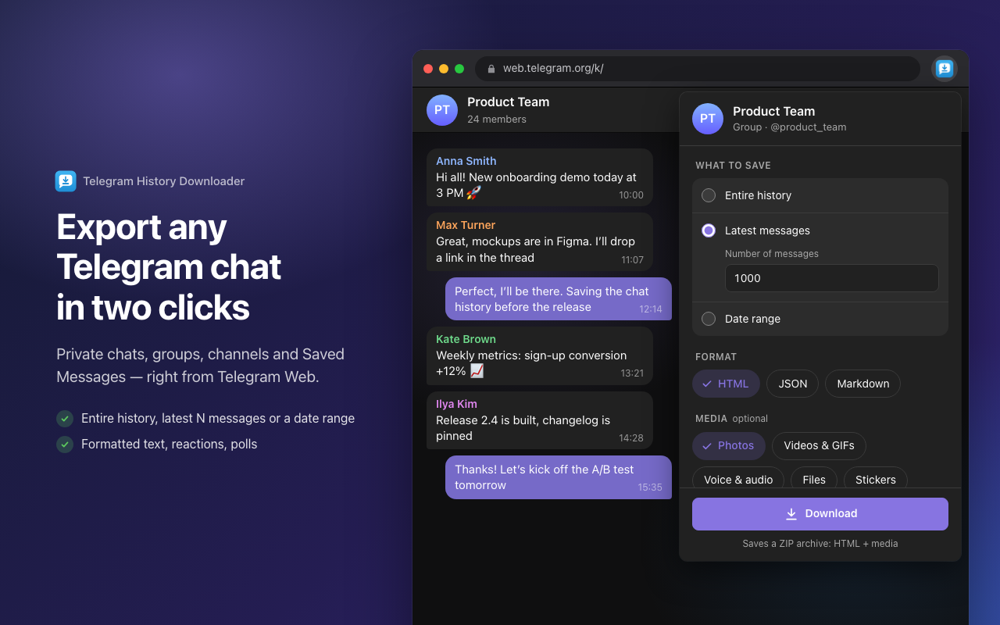
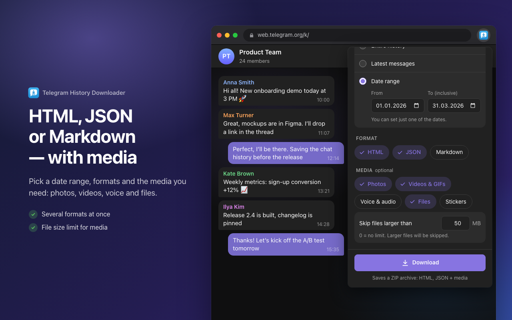
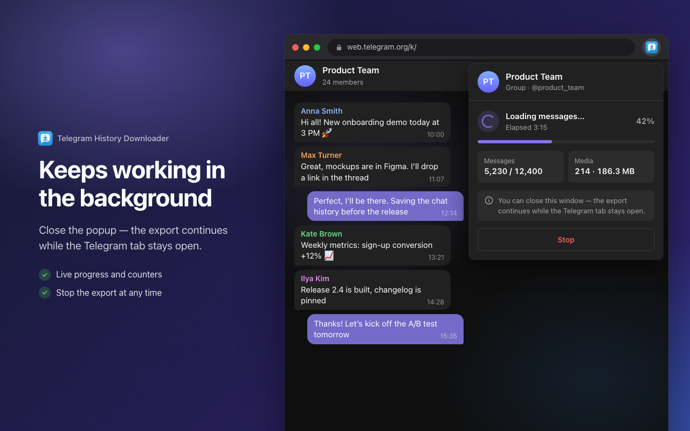
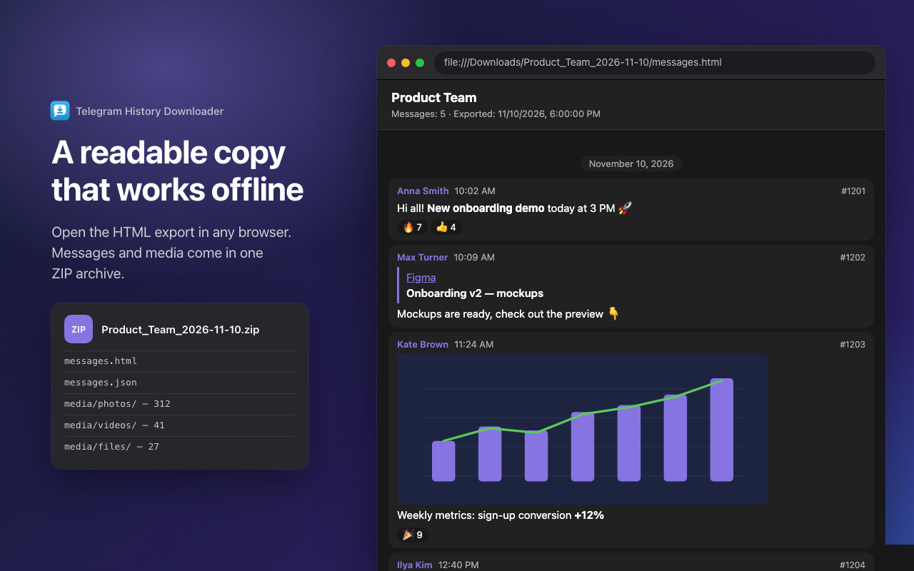
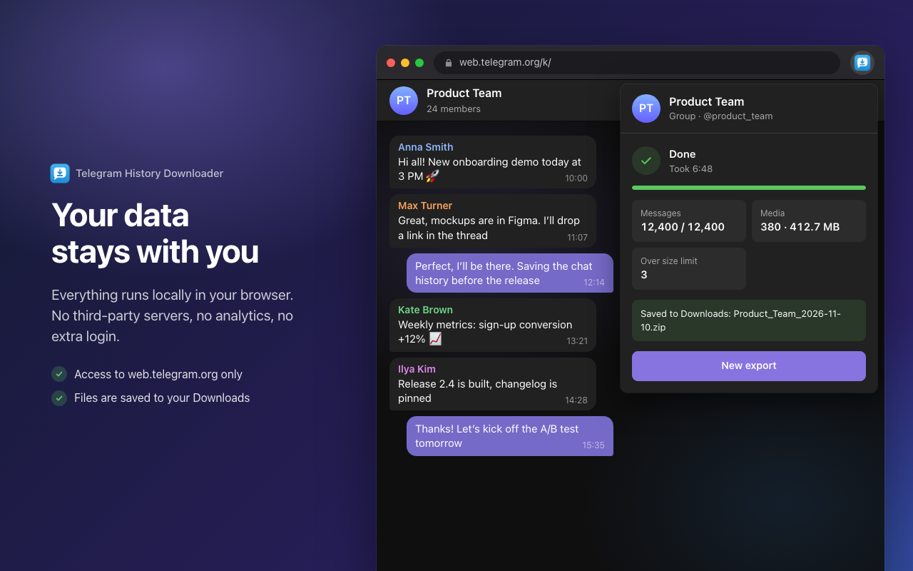

Русский — [`screenshots/ru/`](screenshots/ru/):

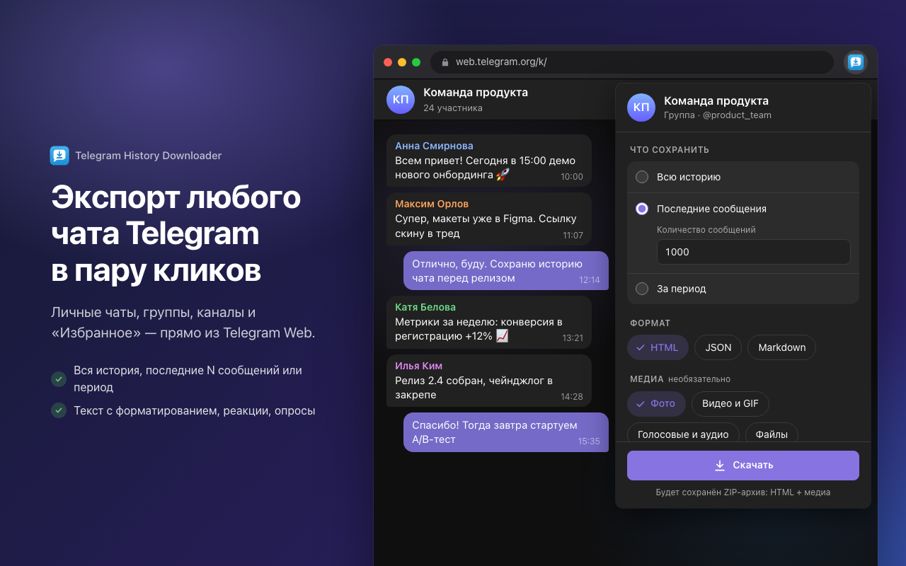
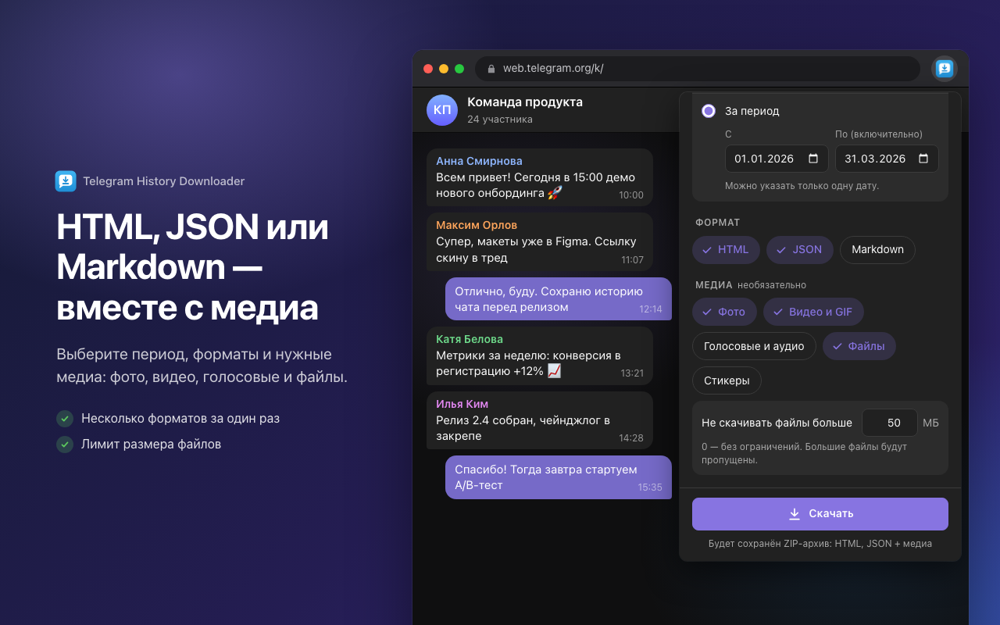
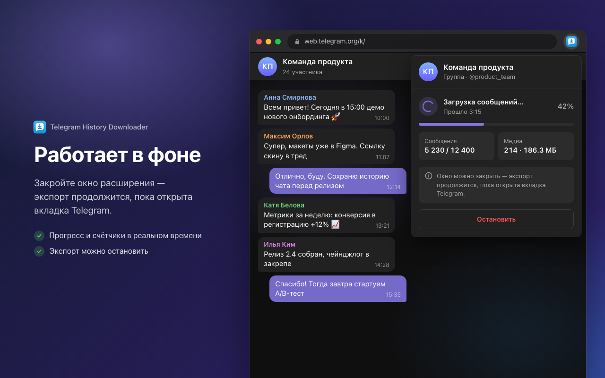
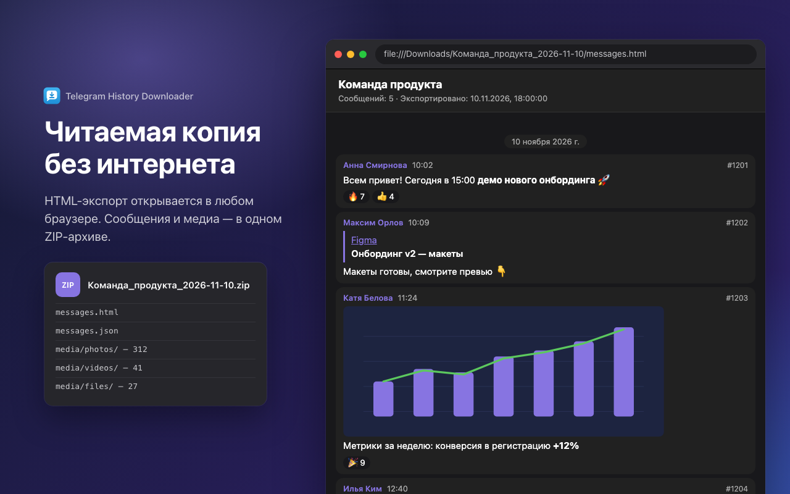
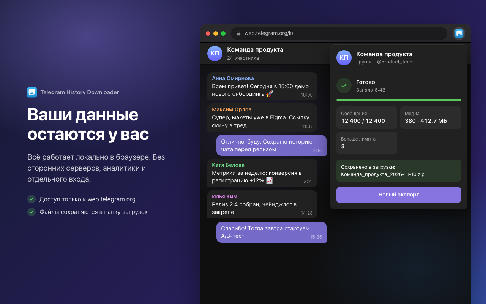

Скриншоты и промо-изображения генерируются скриптом, поэтому после изменений интерфейса их легко обновить:

```bash
npm run screenshots              # собрать расширение и перегенерировать скриншоты
npm run screenshots -- --no-build  # без пересборки
```

Как это работает (`scripts/screenshots/`):

- в кадре настоящий собранный попап из `dist/` с подменёнными `chrome.*` API (`stub.js`) и демо-данными (`data.mjs`);
- на 4-м скриншоте — настоящий HTML-экспорт, отрисованный кодом расширения (`src/main/formats/html.ts`) по демо-переписке;
- окно браузера и чат на фоне — это вёрстка (`scene.css`), а не настоящий Telegram Web. Логотипов Telegram и реальных переписок в кадре нет;
- кадры снимает headless Google Chrome (путь можно задать в `CHROME_PATH`), затем скрипт убирает альфа-канал из PNG;
- тексты заголовков на скриншотах лежат в `data.mjs`, подписи интерфейса берутся из `public/_locales/*/messages.json`.

### Промо-изображения

Требования магазина: JPEG или 24-битный PNG без альфа-канала. Промо-изображения необязательны, но расширения без малого промо-изображения показываются в подборках после тех, у кого оно есть. Без большого изображения расширение не попадёт в баннер-карусель на главной.

Промо-изображения, в отличие от скриншотов, не локализуются, поэтому они на английском, с минимумом текста. По [рекомендациям](https://developer.chrome.com/docs/webstore/images#promo): насыщенные цвета, без белого и светло-серого фона, изображение заполняет всё поле и читается при уменьшении вдвое.

| Изображение | Размер | Файл |
| --- | --- | --- |
| Маленькое рекламное изображение | 440×280 | [`promo/small-440x280.png`](promo/small-440x280.png) |
| Очень большое рекламное изображение (marquee) | 1400×560 | [`promo/marquee-1400x560.png`](promo/marquee-1400x560.png) |

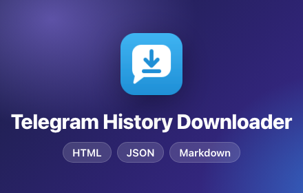

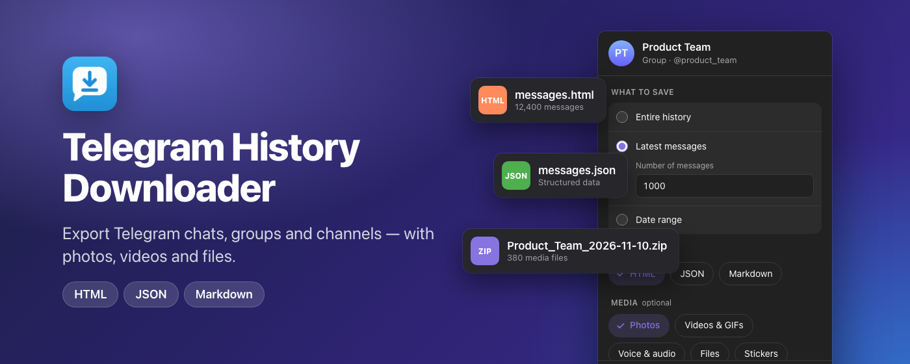

Промо-изображения генерируются той же командой `npm run screenshots`. Оформление задаётся в `scripts/screenshots/promo.css`, разметка — в функции `promoPage` в `generate.mjs`. Если поменяется название расширения (`extName`), изображения обновятся сами.

## Privacy practices (вкладка Privacy)

### Single purpose

```text
Export the message history of the currently open Telegram Web chat, group or channel to local files (HTML, JSON, Markdown, optionally with media).
```

### Обоснование разрешений

`storage`:

```text
Saves the user's export settings (range, formats, media types, file size limit) so they are restored the next time the popup is opened. No message content is stored.
```

`scripting`:

```text
Injects the extension's own content scripts into an already open web.telegram.org tab if it was opened before the extension was installed or updated, so the export can start without reloading the page.
```

Host permission `https://web.telegram.org/*`:

```text
The export runs inside the Telegram Web tab and reads the history of the chat the user has opened through the existing Telegram Web session. The extension doesn't access any other sites.
```

Remote code:

```text
No. All code is bundled in the extension package; no remote scripts are loaded or executed.
```

### Data usage

Расширение ничего не отправляет разработчику или третьим лицам. Но по [FAQ Chrome Web Store](https://developer.chrome.com/docs/webstore/program-policies/user-data-faq) (вопрос 3) обработку данных нужно раскрывать, **даже если они обрабатываются только локально**. Любое расхождение между анкетой, политикой конфиденциальности и реальным поведением расширения считается нарушением. Последствия вплоть до блокировки всех расширений разработчика.

Анкета «Какие данные пользователей вы планируете собирать» — отметки по фактическому поведению кода:

| Категория | Отметка | Почему |
| --- | --- | --- |
| Информация, позволяющая идентифицировать личность | ✅ | В экспорт попадают имена, юзернеймы и Telegram ID авторов сообщений, телефоны из отправленных контактов |
| Медицинская информация | — | Не обрабатывается |
| Финансовые и платёжные данные | — | Не обрабатываются |
| Данные для аутентификации | — | Используется уже открытая сессия Telegram Web; пароли, токены и cookies расширение не читает |
| Личная коммуникация | ✅ | Основная функция — экспорт сообщений из чатов |
| Данные о местоположении | — | Местоположение пользователя не определяется. Геопозиции из сообщений — часть переписки и покрываются «Личной коммуникацией» |
| История веб-поиска | — | Адрес активной вкладки проверяется только для того, чтобы понять, открыт ли web.telegram.org/k/; он нигде не сохраняется |
| Действия пользователей | — | Клики, нажатия клавиш, прокрутка и сетевой трафик не отслеживаются. Сохранённые настройки формы — не действия пользователя |
| Содержимое сайтов | ✅ | Расширение считывает с web.telegram.org текст, изображения, видео, файлы и ссылки |

Подтвердить все три пункта:

- данные не продаются и не передаются, кроме разрешённых случаев;
- данные не используются в целях, не связанных с основной функцией;
- данные не используются для оценки платёжеспособности или кредитования.

### Политика конфиденциальности

Политика на английском и русском лежит в [`privacy-policy.md`](privacy-policy.md). В ней есть обязательное заявление о соответствии требованиям Limited Use. В поле Privacy policy URL указать ссылку на файл на GitHub:

```text
https://github.com/itcaat/telegram-history-downloader/blob/main/docs/privacy-policy.md
```

Ссылка заработает после того, как `docs/` будет запушен в `main`. Если расширение начнёт обрабатывать данные иначе, нужно одновременно обновить политику (с новой датой), анкету в дашборде и этот документ.
